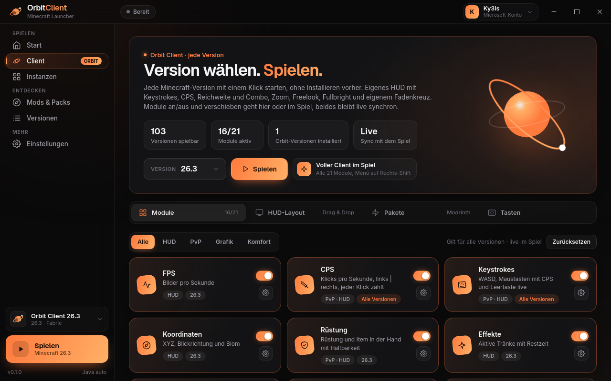
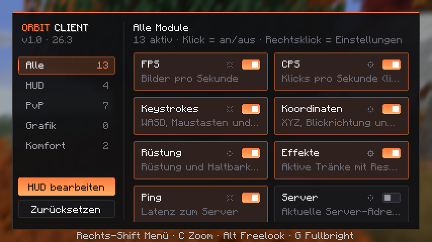

# Orbit Client

Eigener Minecraft-Client mit Launcher für Windows, im Design von OrbitTweak: C# .NET 8 WPF-Host + WebView2-Oberfläche (HTML/CSS/JS) als eine selbstständige `.exe`, dazu ein eigener Fabric-Mod für die Ingame-Features.





## Was drin ist

| Bereich | Umsetzung |
|---|---|
| **Alle Versionen** | Mojang Version Manifest (piston-meta): Releases, Snapshots, Beta, Alpha. Client, Bibliotheken, Natives, Assets (inkl. Legacy/virtual) und Log-Config werden geladen, SHA-1 geprüft, die Startargumente werden wie beim offiziellen Launcher gebaut (Rules, Features, `default-user-jvm`, alte `minecraftArguments`). |
| **Mod-Loader** | Fabric und Quilt über ihre Meta-APIs (Profile mit `inheritsFrom`), Forge und NeoForge über ihre offiziellen Installer (`--installClient`, headless). |
| **Instanzen** | Eigener Ordner pro Instanz, eigene Version, Loader, RAM, Java, JVM-Argumente, Fenstergröße. Spielzeit, Konsole mit Log, Crash-Erkennung. |
| **Modrinth** | Suche mit Filtern (Version, Loader, Kategorien, Sortierung), Detailansicht, 1-Klick-Install mit Abhängigkeiten, Updates (`version_files/update`), Entfernen/Deaktivieren. Mods, Modpacks, Ressourcenpakete, Shader. `.mrpack`-Import (Datei oder direkt von Modrinth). |
| **Orbit Client (eigener Mod)** | `client-mod/`: eigener Fabric-Mod für 26.3 mit 21 Modulen: HUD (FPS, CPS pro Klick, Keystrokes, Koordinaten/Richtung/Biom, Rüstung mit Haltbarkeit, Effekte, Ping, Server, Uhrzeit, RAM, Tempo, Sitzung), PvP (Reichweite, Combo), Zoom (weich, Mausrad), Freelook, Fullbright, eigenes Fadenkreuz, Toggle Sprint, ruhige Kamera. Mod-Menü auf Rechts-Shift, HUD-Editor mit Drag & Drop, Einrasten und Größe per Mausrad, Chroma-Farben. |
| **Jede Version, direkt spielen** | Auf der Client-Seite Version wählen und „Spielen“ drücken, kein Installieren vorher. Die Orbit-Instanz für die Version wird beim ersten Start automatisch angelegt: 26.3 mit vollem Ingame-Client (Mod), andere Fabric-Versionen mit Performance-Paketen, alle übrigen Vanilla. Auf Versionen ohne Mod zeichnet die exe ein Overlay-HUD über das Spiel (Keystrokes, CPS, Fadenkreuz, Uhr, Sitzung, RAM), nur sichtbar im Spiel, nicht in Menüs. |
| **Live-Sync** | Eine gemeinsame `orbitclient.json` im Launcher-Ordner (der Mod bekommt sie per `-Dorbit.config`). Änderungen im Launcher sind nach unter einer Sekunde im Spiel, Änderungen im Spiel (Menü, HUD-Editor) erscheinen per Dateiüberwachung sofort im Launcher und im Overlay. |
| **Client im Launcher** | Seite „Client“: Module an/aus und alle Einstellungen, HUD-Layout per Drag & Drop direkt im Launcher, Performance-Pakete (Sodium, Iris …) von Modrinth, Tastenbelegung. Launcher und Spiel teilen sich `config/orbitclient.json`, Änderungen greifen live im laufenden Spiel. Die Akzentfarbe des Launchers gilt auch im Ingame-Menü. |
| **Microsoft-Login** | OAuth Device-Code-Flow (Microsoft identity platform) → Xbox Live → XSTS → Minecraft Services. Kein Passwort, nur das Refresh-Token, verschlüsselt per DPAPI (CurrentUser). Kein Offline-/Cracked-Modus. |
| **Java** | Pro Version automatisch: Mojangs Java-Runtime-Manifest, Fallback Eclipse Temurin (Adoptium). Eigener Pfad pro Instanz oder global möglich. |

## Azure-App für den Login

Microsoft lässt Minecraft-Logins nur mit einer **eigenen, von Mojang freigeschalteten Azure-App** zu:

1. Auf portal.azure.com eine App registrieren (Kontotyp: *Persönliche Microsoft-Konten*), unter *Authentifizierung* „Öffentliche Clientflows zulassen“ aktivieren.
2. Über Mojangs Formular Zugriff auf die Minecraft-API für diese App-ID beantragen.
3. Die Client-ID im Launcher unter *Einstellungen → Konto* eintragen.

Ohne freigeschaltete App gibt die Minecraft-API beim Login einen Fehler zurück. Eine fremde Client-ID (z. B. die des offiziellen Launchers) wird bewusst nicht benutzt.

## Bauen

```bash
# 1. Client-Mod (braucht JDK 25)
cd client-mod && ./gradlew build && cp build/libs/orbitclient-1.0.0.jar ../Assets/orbitclient.jar && cd ..
# 2. Launcher (bettet Web/ und Assets/orbitclient.jar ein)
dotnet publish -c Release -o publish
```

Der Launcher legt den Mod beim Installieren und vor jedem Start automatisch in die Orbit-Client-Instanz (und aktualisiert ihn nach Launcher-Updates).

Ergebnis: `publish/OrbitLauncher.exe` (win-x64, self-contained, single file). Daten liegen unter `%APPDATA%\OrbitLauncher` (`versions`, `libraries`, `assets`, `runtime`, `instances`).

## Testen ohne Windows

- **Oberfläche:** `Web/` mit einem beliebigen Webserver ausliefern (`python3 -m http.server`). Ohne WebView2 springt ein Mock-Backend in `app.js` ein, das Versionen, Modrinth und Patch Notes live abfragt.
- **Core:** `tests/CoreCheck` ist eine plattformübergreifende Konsolen-App, die den echten Core nutzt:
  ```bash
  cd tests/CoreCheck && dotnet run -c Release -- <datenordner> vanilla 1.8.9
  dotnet run -c Release -- <datenordner> fabric 1.21.11
  dotnet run -c Release -- <datenordner> loader neoforge 1.21.1
  dotnet run -c Release -- <datenordner> orbit
  dotnet run -c Release -- <datenordner> client <orbitclient.jar> menu,settings,editor   # Ingame-Screenshots per -Dorbit.autotest
  dotnet run -c Release -- <datenordner> mrpack fabulously-optimized
  ```
  Der Testmodus startet Java mit einer Platzhalter-Session, nur um Dateien und Kommandozeile zu prüfen. Die App selbst startet ausschließlich mit Microsoft-Session.

## Projektaufbau

```
client-mod/    Orbit-Client-Fabric-Mod (Java 25, Mojang-Namen, Fabric API)
Core/          Plattformunabhängige Logik (Downloads, Versionen, Start, Java, Loader, Modrinth, Auth, Orbit Client)
Web/           Oberfläche (index.html, style.css, app.js, Schriften)
MainWindow.*   WPF-Fenster + WebView2-Brücke ({id,cmd,args} ↔ {id,ok,data}, Events per Emit)
tests/CoreCheck Smoke-Test für den Core
```

## Rechtliches

Nicht offiziell, nicht verbunden mit Mojang, Microsoft oder Modrinth. Der Orbit-Client-Mod ist komplett eigener Code (MIT). Minecraft ist eine Marke von Mojang AB. Spieldateien kommen direkt von Mojang, Mods von Modrinth unter den Lizenzen ihrer Autoren. Schriften: Geist und Inter (SIL OFL). Icons im Stil von Lucide (ISC).
