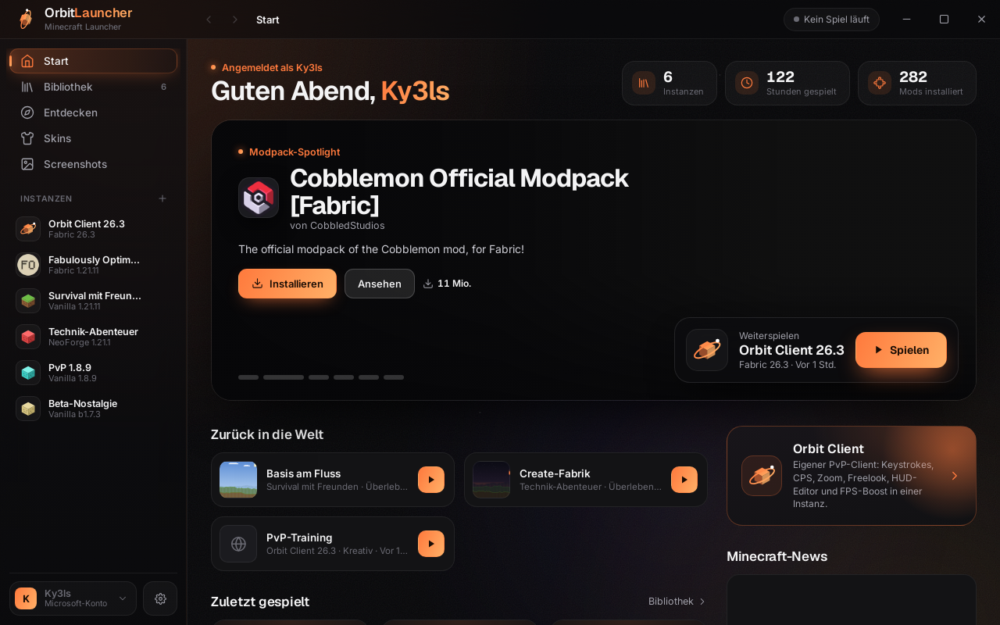
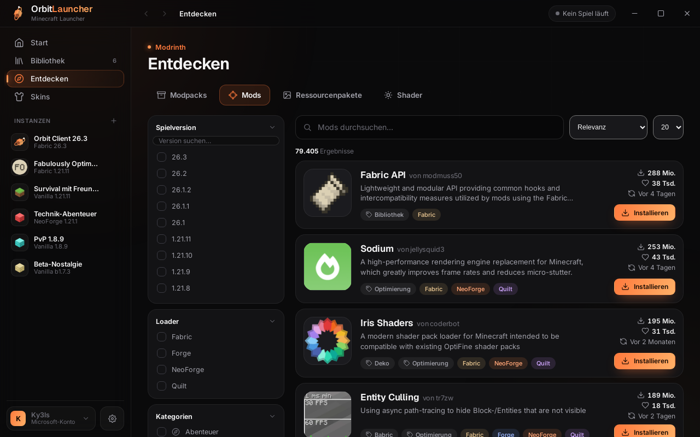
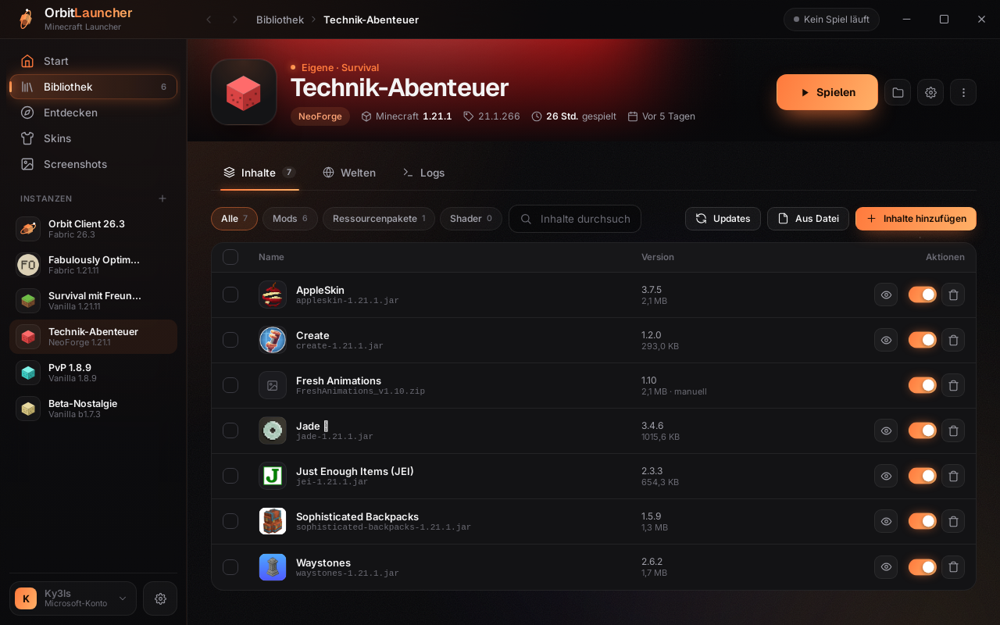

# OrbitLauncher

Minecraft-Launcher für Windows: C# .NET 8 WPF-Host + WebView2-Oberfläche (HTML/CSS/JS) als eine selbstständige `.exe`. Dazu der eigene Orbit-Client-Mod für PvP-Features.







## Was drin ist

| Bereich | Umsetzung |
|---|---|
| **Start** | Weiterspielen (letzte Instanz), direkt zurück in die letzten Welten, zuletzt gespielte Instanzen, beliebte Modpacks, Mods und Shader, Minecraft-News. |
| **Bibliothek** | Alle Instanzen als Karten: Filter (Modpacks, Eigene, Orbit Client), Suche, Sortieren (zuletzt gespielt, Name, neu, Spielzeit, Version), Gruppieren (Gruppe, Loader, Version). Rechtsklick-Menü: Spielen, Inhalte hinzufügen, Einstellungen, Ordner, Duplizieren, Löschen. |
| **Instanzseite** | Kopf mit Spielen/Beenden, Spielzeit, Loader. Tabs: **Inhalte** (Mods, Ressourcenpakete, Shader mit Icons, Suche, Filter, an/aus, Mehrfachauswahl, Updates prüfen und alle aktualisieren, aus Datei hinzufügen), **Welten** (Spielmodus, Symbol, direkt in die Welt starten ab 1.20, Server aus der Serverliste direkt beitreten, Welt in den Papierkorb), **Logs** (Live-Konsole und alte Logs/Crash-Reports mit Suche), **Orbit Client** (nur bei Orbit-Instanzen: Module, HUD-Editor, Tasten). |
| **Instanz-Einstellungen** | Name, Symbol, Gruppe; Version und Mod-Loader nachträglich wechseln, Dateien prüfen und reparieren; Java-Pfad, RAM, JVM-Argumente; Fenstergröße. |
| **Entdecken** | Zwei Mod-Kataloge (Standard und Erweitert) umschaltbar. Modpacks, Mods, Ressourcenpakete, Shader, Listen- oder Kachelansicht. Filterleiste: Spielversion, Loader, alle Kategorien, Umgebung (Client/Server), Open Source. Sortieren, Seiten, aktive Filter als Chips. Aus einer Instanz heraus: nur passende Inhalte, „Installiert“-Markierung. |
| **Projektseite** | Beschreibung (Markdown und HTML, bereinigt), Versionen mit Filtern und Changelog, Galerie mit Großansicht, Kompatibilität, Links, Ersteller, Lizenz. Installieren mit Instanzauswahl (passende oben) oder „Neue Instanz dafür“. Abhängigkeiten kommen automatisch mit. |
| **Welten & Server** | Live-Status der gespeicherten Server (Spieler, Ping, MOTD, Icon), direkt beitreten, Welt-Backups als Zip mit Wiederherstellen. |
| **Teilen & Umziehen** | Instanz als .mrpack exportieren (Katalog-Mods verlinkt, Rest in overrides). Import von .mrpack und .zip-Modpacks, Instanzen aus Prism Launcher, MultiMC, PolyMC und weiteren Launchern übernehmen. |
| **Screenshots** | Galerie aller Screenshots aus allen Instanzen mit Filter. |
| **Discord** | Zeigt „Spielt …“ mit Instanz und Version (abschaltbar). |
| **Skins** | Skin-Bibliothek mit 3D-Ansicht (drehen, laufen), Klassisch/Schlank, mit einem Klick fürs Konto übernehmen, Umhang wählen. Über die offizielle Minecraft-Services-API. |
| **Alle Versionen & Loader** | Mojang Version Manifest (Releases, Snapshots, Beta, Alpha), Fabric, Quilt, Forge, NeoForge. Startargumente wie beim offiziellen Launcher. |
| **Orbit Client (eigener Mod)** | `client-mod/`: Fabric-Mod für 26.3 mit 21 Modulen (Keystrokes, CPS, Koordinaten, Rüstung, Zoom, Freelook, Fullbright, Fadenkreuz, Toggle Sprint …), Mod-Menü auf Rechts-Shift, HUD-Editor. Einstellungen live zwischen Launcher und Spiel synchron. Anlegen über „Neue Instanz → Orbit Client“. |
| **Orbit-Konto & Cloud-Sync** | Eigenes Orbit-Konto: Instanzen (Version, Loader, Gruppe, RAM, Spielzeit, options.txt, Server, Configs), Mod-Listen mit exakter Version, Einstellungen, Orbit-Client-HUD und Skins liegen auf dem Konto. Auf einem anderen PC anmelden, alles kommt zurück, Mods werden frisch aus dem Katalog geladen. Server: `server/` (Cloudflare Worker + D1). |
| **Über den offiziellen Launcher spielen** | Ohne eigene Microsoft-App-ID: OrbitLauncher bereitet alles vor, legt ein Profil im offiziellen Minecraft Launcher an (Spielordner = Instanz) und öffnet ihn. Anmeldung und Start dort. |
| **Microsoft-Login** | Offizielles Microsoft-Fenster in der App (Auth-Code + PKCE) → Xbox Live → XSTS → Minecraft. Nur das Refresh-Token wird gespeichert, verschlüsselt per DPAPI. Mehrere Konten. Kein Offline-/Cracked-Modus. |
| **Java** | Pro Version automatisch: Mojangs Java-Runtime, sonst Eclipse Temurin. |
| **Komfort** | Zurück/Vor wie im Browser (auch Maustasten 4/5), Brotkrümel, Download-Anzeige mit allen laufenden Aufgaben, laufendes Spiel oben mit Logs und Beenden, Speicherbelegung und Cache leeren, 15 Akzentfarben. |

## Microsoft-Login (einmalig für dich als Entwickler)

Spieler klicken nur auf **„Mit Microsoft anmelden“**: Es öffnet sich die offizielle Microsoft-Anmeldeseite in einem Fenster der App (Authorization Code + PKCE), danach Xbox Live → XSTS → Minecraft. Kein Code-Abtippen, kein Azure-Feld, kein Passwort im Client.

Wie bei jedem Client (Lunar, Feather …) braucht die App dafür **eine eigene, von Mojang freigeschaltete Microsoft-App-ID**. Das machst nur du, einmal:

1. Auf portal.azure.com eine App registrieren, Kontotyp *Persönliche Microsoft-Konten*.
2. Unter *Authentifizierung* eine Plattform *Mobile und Desktop* mit der Redirect-URI `https://login.microsoftonline.com/common/oauth2/nativeclient` hinzufügen und „Öffentliche Clientflows“ erlauben.
3. Über Mojangs Formular Zugriff auf die Minecraft-API für diese App-ID beantragen (dauert ein paar Tage).
4. Die ID fest in die exe bauen: `dotnet publish -c Release -o publish -p:OrbitClientId=<deine-app-id>`

Die App-ID des offiziellen Minecraft-Launchers wird bewusst nicht benutzt.

## Erweiterter Katalog

Der erweiterte Mod-Katalog braucht einen eigenen, kostenlosen API-Schlüssel. Entweder in der App unter Einstellungen → Quellen eintragen oder fest einbauen: `dotnet publish -c Release -o publish -p:CatalogKey=<schlüssel>`. Mods, deren Autoren Downloads nur über ihre eigene Website erlauben, werden nicht geladen, sondern verlinkt.

## Bauen

```bash
# 1. Client-Mod (braucht JDK 25)
cd client-mod && ./gradlew build && cp build/libs/orbitclient-1.0.0.jar ../Assets/orbitclient.jar && cd ..
# 2. Client-exe (bettet Web/, Assets/orbitclient.jar und die Microsoft-App-ID ein)
dotnet publish -c Release -o publish -p:OrbitClientId=<deine-app-id>
```

Der Launcher legt den Mod beim Installieren und vor jedem Start automatisch in die Orbit-Client-Instanz (und aktualisiert ihn nach Launcher-Updates).

Ergebnis: `publish/OrbitLauncher.exe` (win-x64, self-contained, single file). Daten liegen unter `%APPDATA%\OrbitLauncher` (`versions`, `libraries`, `assets`, `runtime`, `instances`).

## Testen ohne Windows

- **Oberfläche:** `Web/` mit einem beliebigen Webserver ausliefern (`python3 -m http.server`). Ohne WebView2 springt ein Mock-Backend in `app.js` ein, das Versionen, Mods und Patch Notes live abfragt.
- **Core:** `tests/CoreCheck` ist eine plattformübergreifende Konsolen-App, die den echten Core nutzt:
  ```bash
  cd tests/CoreCheck && dotnet run -c Release -- <datenordner> vanilla 1.8.9
  dotnet run -c Release -- <datenordner> fabric 1.21.11
  dotnet run -c Release -- <datenordner> loader neoforge 1.21.1
  dotnet run -c Release -- <datenordner> orbit
  dotnet run -c Release -- <datenordner> client <orbitclient.jar> menu,settings,editor   # Ingame-Screenshots per -Dorbit.autotest
  dotnet run -c Release -- <datenordner> mrpack fabulously-optimized
  ```
  Der Testmodus startet Java mit einer Platzhalter-Session, nur um Dateien und Kommandozeile zu prüfen. Die App selbst startet ausschließlich mit Microsoft-Session.

## Projektaufbau

```
client-mod/    Orbit-Client-Fabric-Mod (Java 25, Mojang-Namen, Fabric API)
Core/          Plattformunabhängige Logik (Downloads, Versionen, Start, Java, Loader, Mod-Kataloge, Auth, Cloud, Orbit Client)
Web/           Oberfläche (index.html, style.css, app.js, Schriften)
MainWindow.*   WPF-Fenster + WebView2-Brücke ({id,cmd,args} ↔ {id,ok,data}, Events per Emit)
tests/CoreCheck Smoke-Test für den Core
```

## Rechtliches

Nicht offiziell, nicht verbunden mit Mojang oder Microsoft. Der Orbit-Client-Mod ist komplett eigener Code (MIT). Minecraft ist eine Marke von Mojang AB. Spieldateien kommen direkt von Mojang, Mods direkt von den Plattformen ihrer Autoren, jeweils unter deren Lizenz. Schriften: Geist und Inter (SIL OFL). Icons im Stil von Lucide (ISC).
