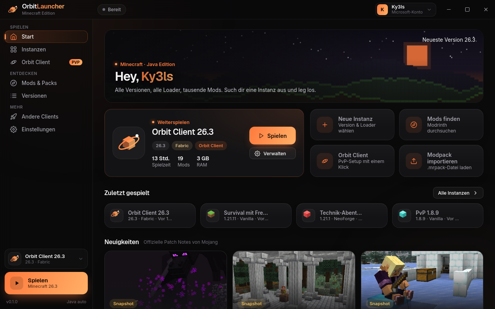

# OrbitLauncher

Minecraft-Launcher für Windows im Design von OrbitTweak: C# .NET 8 WPF-Host + WebView2-Oberfläche (HTML/CSS/JS), als eine selbstständige `.exe`.



## Was drin ist

| Bereich | Umsetzung |
|---|---|
| **Alle Versionen** | Mojang Version Manifest (piston-meta): Releases, Snapshots, Beta, Alpha. Client, Bibliotheken, Natives, Assets (inkl. Legacy/virtual) und Log-Config werden geladen, SHA-1 geprüft, die Startargumente werden wie beim offiziellen Launcher gebaut (Rules, Features, `default-user-jvm`, alte `minecraftArguments`). |
| **Mod-Loader** | Fabric und Quilt über ihre Meta-APIs (Profile mit `inheritsFrom`), Forge und NeoForge über ihre offiziellen Installer (`--installClient`, headless). |
| **Instanzen** | Eigener Ordner pro Instanz, eigene Version, Loader, RAM, Java, JVM-Argumente, Fenstergröße. Spielzeit, Konsole mit Log, Crash-Erkennung. |
| **Modrinth** | Suche mit Filtern (Version, Loader, Kategorien, Sortierung), Detailansicht, 1-Klick-Install mit Abhängigkeiten, Updates (`version_files/update`), Entfernen/Deaktivieren. Mods, Modpacks, Ressourcenpakete, Shader. `.mrpack`-Import (Datei oder direkt von Modrinth). |
| **Orbit Client** | PvP/QoL-Fabric-Setup per Klick aus offenen Modrinth-Mods (Sodium, Lithium, Iris, AxolotlClient-HUD, Zoomify, Freelook, AppleSkin …). Nichts davon ist eingebaut, alles wird zur Laufzeit von Modrinth geladen. |
| **Andere Clients** | Erkennt installierte Lunar Client, LabyMod, Badlion, Feather und den offiziellen Launcher und startet deren eigene Programme. Keine Assets oder Code von denen. |
| **Microsoft-Login** | OAuth Device-Code-Flow (Microsoft identity platform) → Xbox Live → XSTS → Minecraft Services. Kein Passwort, nur das Refresh-Token, verschlüsselt per DPAPI (CurrentUser). Kein Offline-/Cracked-Modus. |
| **Java** | Pro Version automatisch: Mojangs Java-Runtime-Manifest, Fallback Eclipse Temurin (Adoptium). Eigener Pfad pro Instanz oder global möglich. |

## Azure-App für den Login

Microsoft lässt Minecraft-Logins nur mit einer **eigenen, von Mojang freigeschalteten Azure-App** zu:

1. Auf portal.azure.com eine App registrieren (Kontotyp: *Persönliche Microsoft-Konten*), unter *Authentifizierung* „Öffentliche Clientflows zulassen“ aktivieren.
2. Über Mojangs Formular Zugriff auf die Minecraft-API für diese App-ID beantragen.
3. Die Client-ID im Launcher unter *Einstellungen → Konto* eintragen.

Ohne freigeschaltete App gibt die Minecraft-API beim Login einen Fehler zurück. Eine fremde Client-ID (z. B. die des offiziellen Launchers) wird bewusst nicht benutzt.

## Bauen

```bash
dotnet publish -c Release -o publish
```

Ergebnis: `publish/OrbitLauncher.exe` (win-x64, self-contained, single file). Daten liegen unter `%APPDATA%\OrbitLauncher` (`versions`, `libraries`, `assets`, `runtime`, `instances`).

## Testen ohne Windows

- **Oberfläche:** `Web/` mit einem beliebigen Webserver ausliefern (`python3 -m http.server`). Ohne WebView2 springt ein Mock-Backend in `app.js` ein, das Versionen, Modrinth und Patch Notes live abfragt.
- **Core:** `tests/CoreCheck` ist eine plattformübergreifende Konsolen-App, die den echten Core nutzt:
  ```bash
  cd tests/CoreCheck && dotnet run -c Release -- <datenordner> vanilla 1.8.9
  dotnet run -c Release -- <datenordner> fabric 1.21.11
  dotnet run -c Release -- <datenordner> loader neoforge 1.21.1
  dotnet run -c Release -- <datenordner> orbit
  dotnet run -c Release -- <datenordner> mrpack fabulously-optimized
  ```
  Der Testmodus startet Java mit einer Platzhalter-Session, nur um Dateien und Kommandozeile zu prüfen. Die App selbst startet ausschließlich mit Microsoft-Session.

## Projektaufbau

```
Core/          Plattformunabhängige Logik (Downloads, Versionen, Start, Java, Loader, Modrinth, Auth, Orbit Client)
Web/           Oberfläche (index.html, style.css, app.js, Schriften)
MainWindow.*   WPF-Fenster + WebView2-Brücke ({id,cmd,args} ↔ {id,ok,data}, Events per Emit)
tests/CoreCheck Smoke-Test für den Core
```

## Rechtliches

Nicht offiziell, nicht verbunden mit Mojang, Microsoft, Modrinth, Lunar Client oder LabyMod. Minecraft ist eine Marke von Mojang AB. Spieldateien kommen direkt von Mojang, Mods von Modrinth unter den Lizenzen ihrer Autoren. Schriften: Geist und Inter (SIL OFL). Icons im Stil von Lucide (ISC).
